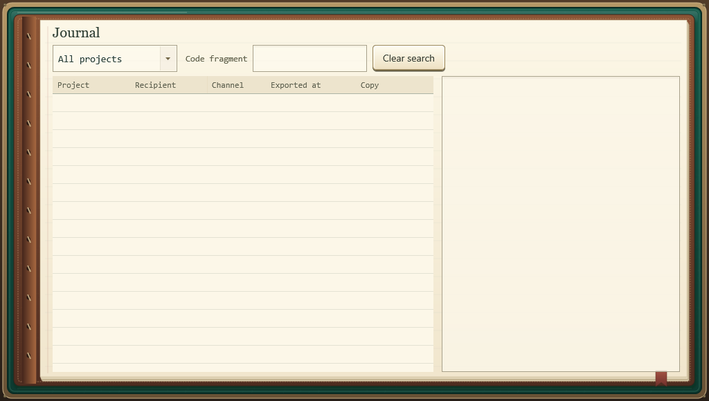
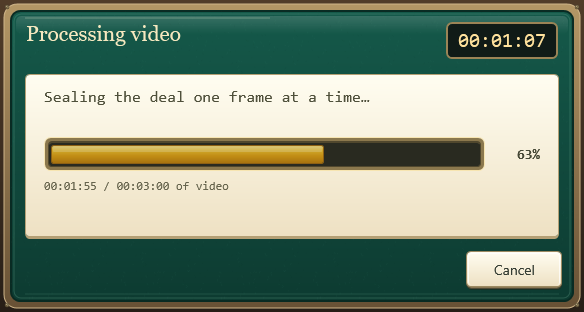

# WaterMarker

WaterMarker создаёт копии изображений, скриншотов и видео с видимой меткой и уникальными
кодами. По коду можно найти запись о получателе и канале в локальном журнале.
Приложение обрабатывает файлы на компьютере и не отправляет их получателям.

Я считаю, что полезный софт тоже может быть прикольным. Поэтому у WaterMarker рабочий
стол с бумагой, телевизором и штампом.


## Как пользоваться

1. Откройте или перетащите на телевизор PNG, JPEG, MP4, MOV или MKV. Для снимка экрана
   нажмите **Screenshot** и выделите область одного монитора.
2. Выберите проект, укажите **Recipient** и **Channel** и проверьте предпросмотр.
   Для видео ползунок под телевизором выбирает момент кадра. Нажмите на штамп
   **Watermark** и выберите имя новой копии в диалоге сохранения.
3. Откройте **Journal**, чтобы просмотреть историю или найти запись по любой части кода.
   Поиск работает по всем проектам и обновляется по мере ввода.



Исходный файл не изменяется, существующие файлы не перезаписываются. Журнал и настройки
хранятся в `%LocalAppData%\WaterMarker`. Для видео доступны отмена обработки и сохранение
в MP4 или MKV с видео H.264 и копированием аудиодорожек. HDR и видео с неизвестной
длительностью пока не поддерживаются.



## Сборка и запуск

Требуются Windows x64 и .NET 10 SDK версии из `global.json` — 10.0.403 или более новый
исправляющий выпуск. В PowerShell из корня проекта:

```powershell
. ./scripts/Initialize-DotNet.ps1
dotnet restore WaterMarker.slnx
dotnet build WaterMarker.slnx --configuration Release
dotnet run --project src/WaterMarker.App
```

Проверка сборки, форматирования и тестов: `./scripts/Verify.ps1`.

Для видео нужны `ffmpeg` и `ffprobe` с кодировщиком `libx264`: поместите их в папку
`ffmpeg` рядом с приложением, добавьте в `PATH` или укажите папку через
`WATERMARKER_FFMPEG_DIRECTORY`. Для изображений и
скриншотов FFmpeg не требуется.

## Устройство

- `WaterMarker.App` — интерфейс WPF и команды.
- `WaterMarker.Core` — модели, правила и сценарий экспорта.
- `WaterMarker.Rendering` — загрузка изображений и отрисовка меток.
- `WaterMarker.Infrastructure` — SQLite, файлы и запуск FFmpeg/FFprobe.

Экспорт резервирует коды в журнале и создаёт временную копию перед сохранением. При
следующем запуске приложение проверяет незавершённые операции и восстанавливает целые копии.

## Лицензирование

Код и документация WaterMarker распространяются по [лицензии MIT](LICENSE).
Правообладатель — Caspian. Условия сторонних компонентов указываются отдельно.

FFmpeg и FFprobe используются как отдельные программы. В среде разработки проверена сборка
`8.0.1-full_build-www.gyan.dev`: она включает `libx264`, а её FFmpeg сообщает GPLv3.
Лицензия другой сборки может отличаться; перед включением FFmpeg в дистрибутив нужно
проверить условия выбранных бинарников и сторонних компонентов. Известные зависимости
описаны в [THIRD-PARTY-NOTICES.md](THIRD-PARTY-NOTICES.md).
