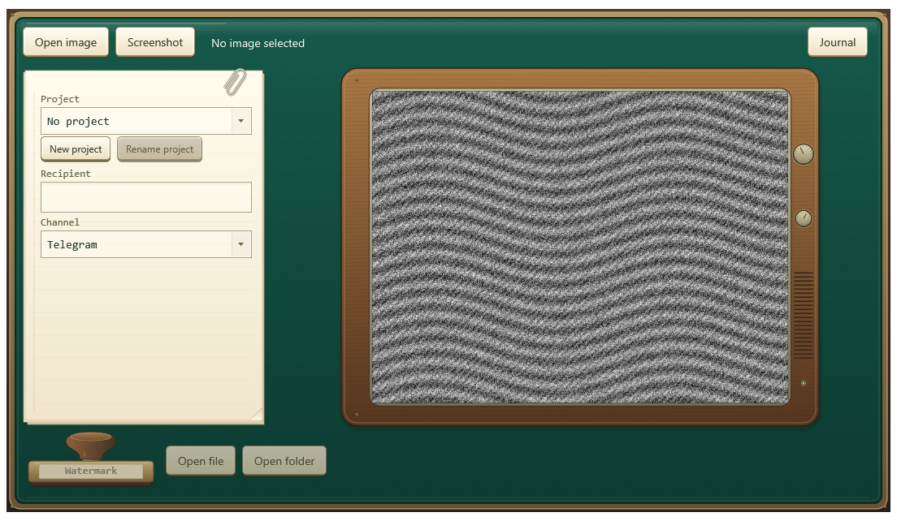

# WaterMarker

WaterMarker создаёт копии изображений, скриншотов и видео с видимой меткой и уникальными
кодами. По коду можно найти запись о получателе и канале в локальном журнале.
Приложение обрабатывает файлы на компьютере и не отправляет их получателям.



## Как пользоваться

1. Откройте или перетащите на телевизор PNG, JPEG, MP4, MOV или MKV. Для снимка экрана
   нажмите **Screenshot** и выделите область одного монитора.
2. Выберите проект, укажите **Recipient** и **Channel** и проверьте предпросмотр.
   Нажмите на штамп **Watermark** и выберите имя новой копии в диалоге сохранения.
3. Откройте **Journal**, чтобы просмотреть историю или найти запись по любой части кода.
   Поиск работает по всем проектам и обновляется по мере ввода.


Исходный файл не изменяется, существующие файлы не перезаписываются. Журнал и настройки
хранятся в `%LocalAppData%\WaterMarker`. Для видео доступны отмена обработки и сохранение
в MP4 или MKV с видео H.264 и копированием аудиодорожек. HDR и видео с неизвестной
длительностью пока не поддерживаются.


## Сборка и запуск

Готовая сборка для Windows x64 опубликована в разделе Releases, распакуйте её
в отдельную папку и запустите `WaterMarker.App.exe`. .NET устанавливать не нужно.

Требуются Windows x64 и .NET 10 SDK версии из `global.json` — 10.0.403 или более новый
исправляющий выпуск. В PowerShell из корня проекта:

```powershell
. ./scripts/Initialize-DotNet.ps1
dotnet restore WaterMarker.slnx
dotnet build WaterMarker.slnx --configuration Release
dotnet run --project src/WaterMarker.App
```
Сборка архива из исходников: `./scripts/Build-Release.ps1 -Version 1.0.0`.

Для видео нужны отдельно установленные `ffmpeg` и `ffprobe` с кодировщиком `libx264`.
Если они отсутствуют, при запуске WaterMarker предложит установить пакет `Gyan.FFmpeg`
через Windows Package Manager. Откроется окно установки, в котором можно ознакомиться
с условиями и установить пакет. Для подготовки окружения разработки
то же действие доступно командой `./scripts/Install-VideoTools.ps1`.

Можно установить FFmpeg самостоятельно и добавить обе утилиты в `PATH` либо указать
их папку через `WATERMARKER_FFMPEG_DIRECTORY`. При отказе от установки изображения
и скриншоты остаются доступны. Для установки через WinGet нужны интернет и
[App Installer](https://learn.microsoft.com/en-us/windows/package-manager/winget/);
если установка не удалась, установите FFmpeg вручную и перезапустите приложение.

## Устройство

- `WaterMarker.App` — интерфейс WPF и команды.
- `WaterMarker.Core` — модели, правила и сценарий экспорта.
- `WaterMarker.Rendering` — загрузка изображений и отрисовка меток.
- `WaterMarker.Infrastructure` — SQLite, файлы и запуск FFmpeg/FFprobe.

Экспорт резервирует коды в журнале и создаёт временную копию перед сохранением. При
следующем запуске приложение проверяет незавершённые операции и восстанавливает целые копии.

## Лицензирование

Код и документация WaterMarker распространяются по [лицензии MIT](LICENSE).
Условия сторонних компонентов указываются отдельно.

FFmpeg и FFprobe устанавливаются отдельно и используются как отдельные программы.
Предлагаемая сборка Gyan включает `libx264` и распространяется по GPLv3; условия
других сборок могут отличаться. Сведения о зависимостях приведены в
[THIRD-PARTY-NOTICES.md](THIRD-PARTY-NOTICES.md).
